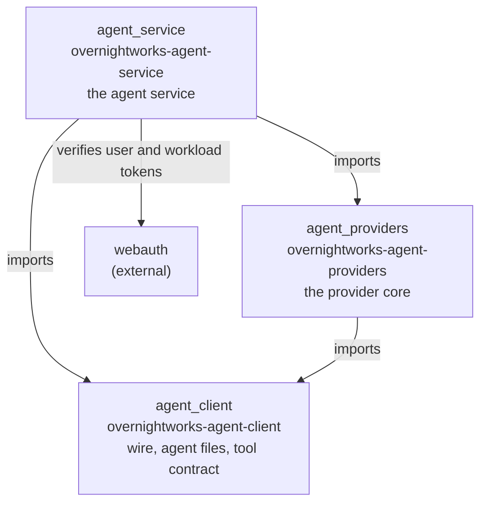
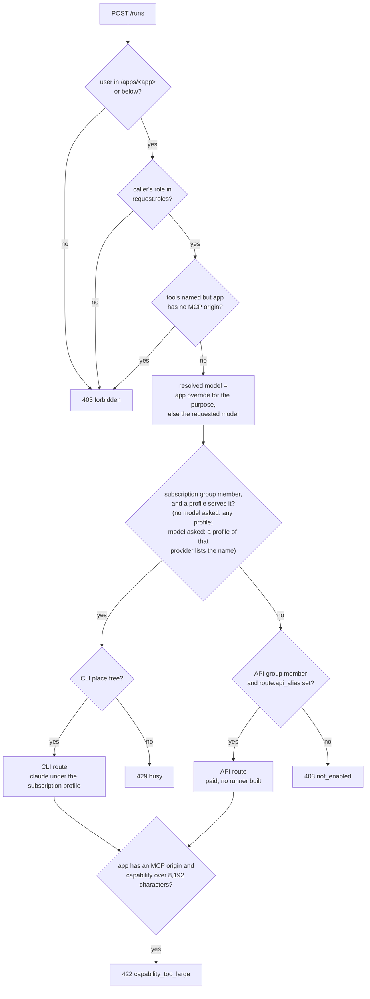

# Architecture

The mental model of this repository, for an engineer who changes it or decides
how a host or an app builds on it. It is an overview: the code and its
docstrings own behaviour, the decision record
[0001](decisions/0001-agent-service.md) owns the service's rulings, and
`AGENTS.md` owns the layout, the checks and the release rules.

## What it is

A library and the service built on it. The library routes a turn to Claude,
Grok or Codex over each provider's CLI or HTTP API and owns the machinery a host
should not rebuild: live model catalogs, readiness probes, a streaming turn
transport, the tool loop, a bounded subprocess runner and the sandbox
directory-name constants. The service is the one authenticated entrance through
which apps start agent runs: one agent service decides who is asking, whether
they may use the operator's subscription, and which route serves them. An app
that starts runs through the service holds no LLM or subscription credential, and
its tools stay with the app.

## The three distributions

Released together from one tag, built in one workspace. The import direction is
enforced by `.importlinter`, which `lint-imports` proves in CI.

*Which package may import which. Source: `.importlinter`, the three
`pyproject.toml` files. Nothing imports the service; only the service imports
`webauth`.*

- The **client** is light: it depends on `pydantic` and `ruamel.yaml` only (plus
  PyJWT with cryptography in `[mcp-server]`) and never imports the core. It owns
  the tool contract `ToolDeclaration`, the agent-file reader, the service's wire
  (the `RunRequest` and the streamed run events), the run capability's format and
  the app side of the MCP profile. An app installs it.
- The **core** depends on the client, `pydantic`, `httpx` and `anyio`, and on
  nothing else: no host application, no web framework, no database. A host
  that runs turns itself installs it.
- The **service** builds on both, runs as `agent-service --config PATH`, and
  alone depends on a web framework.

The service's wire has one owner, `agent_client.wire`. The core's in-process
turn event (`agent_providers.events`) is never a second wire; `agent_service.run_events`
maps it onto the wire.

## How a run is routed

The service decides the route from the caller's groups and the model the agent
runs on, never from the purpose. Every check precedes any child process.

*Question: which route serves this caller? Source:
`agent_service.app._admitted`, `agent_service.routing.route`,
`agent_service.config.ServiceConfig.model_for`. The groups and models are
operator configuration ([operations.md](operations.md)).*

Keycloak decides who may use the subscription and who the paid route, through
groups; the service holds no user list. A requested model is never replaced by
another, except by the app's per-agent override. The API runner is not built, so
an admitted run on the paid route ends `failed: provider_unavailable`.

## Crosscutting concepts

**Host facts come from the host.** The library reaches back into no host.
Deployment facts arrive as configuration (`ProviderRuntimeConfig`) or explicit
arguments; the tool set, the MCP server and the image constraints arrive as
ports (`ToolExecutor`, `ToolCatalog`, `McpServerSpec`, `ImagePolicy`). No path
invents a default for a host fact, and an unconfigured path fails loud.

**One spawn owner, one bounded runner.** Every child is a `ChildProcess` with a
complete environment, an absolute binary and an explicit working directory,
created only in `agent_providers.spawn`. The environment is closed by
convention, not access control; containment is the host's sandbox and the
service's container ([host.md](host.md)).

**Trust.**

- *The issuer is the trust root.* The service alone verifies user and workload
  tokens, against the one configured issuer; identity is the verified `(iss,
  sub)`, never a field of the request body.
- *The service decides, the browser supplies nothing.* The user's browser reaches
  the service only as the access token its app forwards. The app gate and the
  caller's role come from the verified tokens. The request, sent by the app under
  its workload token, supplies the agent's allowed roles, its tools and the
  requested model; configuration decides the rest. It carries no MCP URL, MCP
  token, route or user id.
- *The app owns its tools and their effects.* Tools run in the app, behind its one
  registered MCP origin. The request names the tools and their effects; the
  service signs a per-run capability that grants exactly those names, and the app
  verifies it with the public key ([wire.md](wire.md) has the details).
- *No credential in an app.* The subscription login is one file the operator
  names; an app that starts runs through the service holds none (the interim core
  path in [operations.md](operations.md) is the exception).
