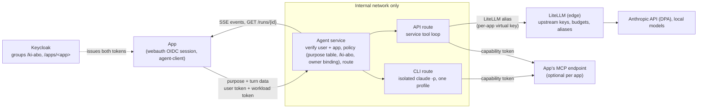

# 0001 — One central agent service

- **Date:** 15.10.2026
- **Decided by:** the operator's rulings of 15.10.2026 and the head rulings H1–H12
  that answered the independent architecture review (Codex, three rounds).
- **Harvested from:** [#18](https://github.com/overnightworks/agent-providers/issues/18).

This record states decisions and their reasons. It describes where the system is
going, not what exists; each slice below makes its part true when it lands.

## Mental model

Apps stop talking to language models themselves. An app sends a **purpose** (a
closed value such as `songmaker.cowriter`), the turn data, and two tokens — the
end user's and its own. One agent service decides who is asking, whether they may
use the operator's subscription, and which route serves the purpose. The app
never names a provider, a model, a route or a user id, and never holds an LLM or
subscription credential.

There are exactly two routes:

- the **CLI route** runs an isolated `claude -p` under a configured subscription
  profile, for members of the Keycloak group `/ki-abo` only;
- the **API route** goes through LiteLLM, which alone maps aliases to upstream
  models and keys.

Tools stay with the app. When an app has tools, the service reaches them through
the app's one registered MCP endpoint with a short-lived capability bound to the
run.



atelier-2 is the explicit exception: it is the operator's own agent tool and
keeps its local executors (see H8).

## Operator rulings

- There is one central LLM gateway.
- The personal subscription is for the operator's own use only. Friends never go
  through it.
- There is one simple place to switch.
- No app container holds a subscription login.
- Who may use a subscription is configured in Keycloak, the one admin place.
- Subscription CLIs serve only the operator's own agents. Local API-key tools may
  use the gateway too.

## H1 Identity

**Context.** A configured-username fallback or a caller-supplied `user_id` lets
any app claim to be anyone.

**Decision.** The app forwards the end user's Keycloak access token, whose
audience includes `agent-service` and whose `azp` is the app's client. The
service checks signature, issuer, audience, expiry, `azp` and the full-path group
claim. The principal is `(iss, sub)`. The RS256 verifier comes from webauth W1
(overnightworks/webauth#51).

**Consequence.** There is one verifier owner and no copy of it here; no request
can name its own user.

### Token shapes (proven by A1a1k)

`tests/test_keycloak_token_shapes.py` fetches real tokens from Keycloak 26.8.1
serving the test realm `tests/keycloak/realm.json`, verifies them with the
webauth verifier, and holds these facts in CI (job `keycloak-token-shapes`):

- A service-account token has `azp == client_id ==` its client, carries realm
  role `agent-workload`, and lives at most 300 s (`exp - iat`).
- A user token never carries `agent-workload`; the role is granted only to
  service-account users. Whether a user token carries `client_id` is recorded,
  not relied on.
- A user token has `azp` equal to the client the user logged in through, `aud`
  containing `agent-service`, and `groups` as full paths (`/ki-abo`,
  `/apps/songmaker`). A user in no group has the claim absent or empty.
- A user token's `sub` differs from every service account's `sub`.
- With Keycloak's built-in default scopes (`basic`, `profile`, `email`,
  `roles`, `web-origins`, `acr`, `service_account`) that the platform realm
  keeps, a workload client is named only by `azp` and `client_id`. Two
  workload clients' service-account tokens also differ in the service-account
  user's own `sub` and `preferred_username`, and in `allowed-origins`, each
  client's web origins (besides `jti` and the times). `preferred_username` is
  `service-account-<clientId>`, so only `sub` is unknowable in advance. `clientAddress` and `clientHost`
  name the calling host; the test calls both clients from one host, so it
  leaves them equal. The workload binding must therefore check `azp` and
  `client_id` against the registry.

### A1a1 ruling (head, 15.10.2026)

**Context.** A1a1 builds the service's entrance, `POST /runs`, against the
token shapes above; the Codex plan review demanded the binding, precedence and
body rules be fixed before the build.

**Decision.**

- **The workload binding (U1').** A workload token binds its app only when it
  carries realm role `agent-workload` (which only service accounts hold), its
  `azp == client_id ==` one registered `workload_client`, `exp - iat` is at
  most 300 s, `sub` is present, and `azp` and `client_id` are non-empty
  strings. `client_id` alone proves nothing. An empty `sub` never reaches the
  binding: webauth's verifier refuses it as an invalid claim, so the token is
  an unusable credential. No refusal is decided from unverified claims. A
  `workload_client` registered for two apps stops startup.
  One process-scoped webauth `JwtVerifier` holds the key-set cache, refresh
  lock and cooldown, and runs off the event loop.
- **The order of checks.** The first failure answers. Verification of the
  workload token, then of the user token, precedes every binding check, so
  each token's 401 or 503 answers before any 403:

  | Check | Answer |
  |---|---|
  | The workload token is missing, or webauth refuses it while parsing it, before it looks up a key (among others: longer than 8192 characters, not a compact JWS whose header and claims set are strict JSON objects, a number that overflows to infinity, a header or claims set nested deeper than 8 levels, a forbidden header member (`crit`, `jku`, `jwk`, `x5u`, `x5c`, `b64`), an `alg` other than RS256, or a missing or invalid `kid`) | 401 `unauthorized`, one body, `WWW-Authenticate: Bearer` |
  | The service holds no current key set and cannot fetch one, or a token's `kid` is missing from a current key set and the refresh fails; this is decided when a token is verified (in practice the workload token, verified first) | 503 `unavailable`, `Retry-After: 30` |
  | The workload token fails its signature, issuer, `aud` ∌ `agent-service` or time check, or has an empty `sub`; these are checked only once a current key set is held | 401 `unauthorized`, one body, `WWW-Authenticate: Bearer` |
  | The user token is missing or not `Authorization: Bearer <token>`, or fails verification as the workload token above; or it has no `sub`, a `sub` that is not valid Unicode text (A1a4 O7), or a malformed group claim | 401 `unauthorized`, one body, `WWW-Authenticate: Bearer` |
  | The workload binding above fails (among others: an absent workload `sub`, an absent or empty `azp` or `client_id`); the user's `azp` differs from the workload's; the user's `sub` equals the workload's | 403 `forbidden` |
  | The body, at most 256 KiB enforced before buffering, parsed as strict JSON (no `NaN`, no member twice): its `v` is absent, not an integer, or not 1 | 400 `unsupported_version` |
  | The body is not strict JSON or not UTF-8 (UTF-16 and UTF-32, with or without a BOM, are refused; a UTF-8 BOM is accepted), too large, or not exactly a `RunRequest` | 422 `invalid_request` |
  | The purpose is not in the app's list | 403 `forbidden` |
  | H5 routing answers `not_enabled`; no run starts | 403 `not_enabled` |
  | The run's capability would exceed 8,192 characters (A1a4 item 12): a subject wider than the preflight's reserve, or a wall clock past 2286 | 422 `capability_too_large` |
  | Admitted | 200 `text/event-stream` |

  Every rejection is a `RunRejection` with `Cache-Control: no-store`, and no
  answer or log line carries token text.
  A token whose `kid` is missing from a still-current key set answers 503
  `unavailable` when the key set cannot be refreshed (webauth v0.13.0 reports
  `KEY_SET_UNAVAILABLE`: the `kid` may be a rotated key it could not fetch),
  and 401 when a successful refresh lacks the `kid`. With no current key set
  the 503 row answers, whatever the `kid`.
- **The policy.** The service reads one TOML file into frozen models that
  forbid unknown fields; a refused file stops startup naming the field.
  `[identity]` names issuer, key-set URL (https), audience, subscription group,
  group claim and the clock leeway `leeway_seconds` (0 to 300, default 0);
  `[runs]` the run's pace and limits: `heartbeat_interval_s` (an integer, 1 to
  300, default 15), `stall_timeout_s` (default 30), `idle_timeout_s`
  (default 120) and `max_duration_s` (default 600), which must satisfy
  heartbeat < stall <= idle < maximum, and the
  budget `max_tool_calls` (default 30) and `max_bytes` (default 4 MiB,
  4194304), both positive integers outside that ordering;
  `[profiles.<name>]` one profile per provider;
  `[purposes."<p>"]` an optional `cli_provider` and `api_alias`;
  `[apps.<app>]` its `workload_client`, its purposes, and its tools' effects,
  where an unlisted tool counts as side-effecting. `agent_service.routing.route`
  is the one pure H5 decider.
- **The stream.** A runner is a port per route; production installs none
  until A1b and A2b, so an admitted run on a route without one ends as
  `failed: provider_unavailable`, never as a success. `agent_service.run_events`
  owns the mapping from the core's turn events onto the wire: a tool call's
  input is deep-copied into its event, and an event that `encode_event` cannot
  write (a non-JSON value, too deep, too large) or that the service's own
  `RunStream` refuses ends the run as `failed: provider_error` before it is
  sent. An event past the run's tool-call or byte budget ends the run as
  `failed: limit_exceeded` before it is sent. The event is encoded and
  charged before `RunStream` records it, so a refused one never advances the
  sequence the client checks.
- **Ruled sentences.** S1 both tokens are required; S2 a user token cannot
  pose as the workload; S3 the request names only purpose and turn; S4 H5
  decides the route; S5 a clean stream ends with exactly one terminal; S6
  non-JSON tool input never reaches the wire; S7 no runner is never a fake
  answer. The threat checklist: token substitution, confused deputy via
  `azp`, cross-app replay, algorithm confusion and key-set DoS (both
  webauth's), token leakage into logs and bodies; stale groups for a token's
  lifetime are accepted.

**Consequence.** Tests prove each row with minted tokens over a real socket,
and `tests/test_service_keycloak.py` proves the entrance end to end with real
Keycloak 26.8.1 tokens in the `keycloak-token-shapes` job.

## H2 Whose subscription

**Context.** The operator wants the subscription settled "an einer zentralen
Stelle", without per-person mapping.

**Decision.** The Keycloak group `/ki-abo` alone decides who may use the
subscription route. Its members use the installation's subscription profiles;
everyone else gets the API route or `not_enabled`. The operator's test accounts
are members of `/ki-abo`.

**Consequence.** A friend put into `/ki-abo` would use the operator's own
subscription, which the consumer terms forbid (architectural reading). The
operator accepted this residual risk; avoiding it is the admin's responsibility.
Per-person subscription mapping waits for a named caller.

## H2b Subscription profiles are configuration

**Context.** The operator holds several subscriptions and wants them adjustable.

**Decision.** A profile is one subscription login, with a name, a provider
(`claude`, `codex`, `grok`), whether background purposes may use it (H12), and
the place its login lives under the secrets owner. There is one profile per
provider. The profile list is service configuration, kept as code in edge; the
login files live in `~/.secrets`, never in a repository.

**Consequence.** Nothing in the code is tied to the operator; another
installation lists its own profiles.

## H3 App identity and tools

**Context.** A user token alone does not prove which app sends the request, and
a request that names its own tools or MCP endpoint could reach anything.

**Decision.**

- Every request carries the forwarded user access token and a short-lived
  Keycloak client-credentials token of the app's own workload client. The
  service checks both; the workload client id must equal the user token's `azp`.
- "Apps hold no keys" means no LLM or subscription credential. The workload
  client secret is an ordinary app credential under the secrets owner.
- A static, server-side app registry maps each workload client to its allowed
  purposes, its own canonical MCP origin, which no other app shares (A1a4 O3), and
  a tool allowlist, the keys of its tools table (A1a4 O5). The request carries no
  MCP URL, MCP token, route, provider, model or user id; the one exception is the
  job ticket of H12.
- The capability is per run, not per call. When the service admits a run it
  mints one RS256 capability (token type `agent-capability+jwt`, at most 8,192
  characters; a larger one refuses the admission as `capability_too_large`) bound
  to the audience (the app's MCP origin), the app, the principal, the run id, the
  purpose and the tool allowlist. It expires at ⌊admission + `[runs]
  max_duration_s`⌋, whether or not the run ended earlier, and nothing revokes it
  (A1a4 O4). The CLI gets it in its per-run MCP
  config header; the API-route tool loop sends the same one. The app's MCP server
  checks it on every request, opens a fresh DB session and re-checks ownership.
- Hardening: redirects are denied, egress is limited to the registered origins,
  Host and Origin are validated, and the service sits on an internal Docker
  network only, with no tunnel line and no Traefik route. The listener stays
  internal-only as defence in depth. mTLS/SPIFFE is out of scope.

**Consequence.** Tool reach is decided once, server-side, per app; a leaked
capability is useful only for one app, one user and one allowlist, until its run's
maximum duration has passed since admission, even after the run ended.

### A1a4 ruling (operator and head, 16.10.2026)

A1a4-1 settles the signing key. A1a4-2a (capability format, size preflight) and
A1a4-2b (minting at admission) extend this ruling; the rule numbers continue there.

**O1 Key generation and custody (operator, 16.10.2026).** The operator creates the
key by hand, never the service. The procedure creates a new file exclusively with
mode 0600 in an operator-controlled directory, refuses any existing destination
including a symlink, and generates rotation candidates at a distinct path before an
explicit replacement of the active key (bash, OpenSSL 3, GNU coreutils):

```bash
(
  set -eu
  umask 077
  dir="$HOME/.secrets/agent-service"
  dest="$dir/signing-key.pem"
  mkdir -p "$dir"
  chmod 700 "$dir"
  tmp="$(mktemp "$dir/.new-signing-key.XXXXXX")"
  trap 'rm -f "$tmp"' EXIT
  openssl genpkey -algorithm RSA -pkeyopt rsa_keygen_bits:3072 -pkeyopt rsa_keygen_pubexp:65537 -out "$tmp"
  ln -T "$tmp" "$dest"
)
```

`mktemp` creates the candidate exclusively, with mode 0600, inside the 0700
directory. `ln -T` (`link(2)`) publishes it under `dest` only when no entry of that
name exists, a dangling or live symlink included, and never follows one. The trap
removes the temporary name in every case. A rotation candidate is the same block
with `dest="$dir/signing-key.next.pem"`. The key is an unencrypted PEM private key
(the procedure writes PKCS#8), RSA-3072 with exponent 65537. `[signing] key_file`
names the absolute path the service sees; the service reads it once at startup and
never creates, rewrites or reloads a key.

**O2 Rotation and compromise (operator, 16.10.2026).** One key exists at a time.
Rotate on a suspected compromise or whenever the operator chooses; there is no
schedule. To rotate:

1. create a candidate at the distinct path (O1);
2. replace the active key with
   `mv -T "$HOME/.secrets/agent-service/signing-key.next.pem" "$HOME/.secrets/agent-service/signing-key.pem"`;
3. restart the service.

The `kid` changes with the key. Restarting stops the service's runs but does not
revoke their capabilities: previously issued tokens remain acceptable until expiry
wherever the old public key remains trusted. Compromise recovery also requires
removing that public key from every verifier and invalidating its cached trust, with
the executable procedure owned by A1m/A1d before live use. webauth, for one, keeps a
fetched key set for an hour. The holder of a compromised private key can mint new
tokens, so waiting until issued capabilities expire is not recovery. No previous
private signing key is kept. This item keeps and publishes no previous public
verification key; whether 24-hour tickets or a published key set need one after a
planned rotation is decided by A1a5 and A1m; such a grace period never applies after a
compromise.

**Decisions.**

- **D1 the cut.** The signing key first, then the capability in two items: A1a4-2a
  (format, `mcp_origin`, size preflight) and A1a4-2b (admission, hand-over, log boundary).
- **D2 where the key enters.** `[signing] key_file`, read and checked while the
  configuration validates, into `config.signing.key`: one read and one refusal path
  (exit 2), and `cli.py` is unchanged.
- **D3 the `kid`.** The RFC 7638 SHA-256 thumbprint of the public key; never configurable.
- **D4 direct dependencies.** `agent_service.signing` imports PyJWT and
  `cryptography`, so the service declares both rather than relying on webauth's extra.
- **D5 publishing.** Nothing is published in A1a4; A1m and A1a5 choose an endpoint or a file.
- **D15 explicit token types.** `SigningKey.sign(claims, token_type)` has no default
  type (RFC 8725 section 3.11). The capability uses `agent-capability+jwt`; A1a5 picks
  its own. webauth and PyJWT do not check `typ`, so a verifier must check it itself.

**Items.**

1. **Where the key comes from.** `[signing]` is optional and holds exactly one
   member, `key_file`, an absolute path (`~` is not expanded) without control or non-printing
   characters. The key is read and
   checked once, at startup. The service never creates, writes, re-reads or reloads
   a key file; a missing file is a refusal, never a generated key.
2. **What file is accepted.** The file is opened once with
   `O_RDONLY | O_NONBLOCK | O_CLOEXEC`; a symlink is followed. Type, mode, size and
   bytes all come from that descriptor; the path is never opened again. It must be a
   regular file granting nothing to group or others (`st_mode & 0o077 == 0`), at most
   16 KiB, holding exactly one unencrypted PEM private key that is RSA with 3072 bits
   and exponent 65537. Every refusal, including `OSError`, `ValueError`, `TypeError`
   and `UnsupportedAlgorithm`, stops startup with exit 2 and one line holding
   `signing.key_file`, the path and the service's own reason, never key bytes or a
   library message. Not covered: an owner who rewrites the opened file, and whether
   the directory holding it is trustworthy (operator and A1d).
3. **The key id.** The RFC 7638 SHA-256 thumbprint of the public key (members `e`,
   `kty`, `n`, sorted, no whitespace, unpadded base64url), 43 characters.
4. **Signing.** `SigningKey.sign(claims, token_type)` returns a compact RS256 JWS
   whose header is exactly `{"alg":"RS256","kid":<kid>,"typ":<token_type>}`; webauth's
   `JwtVerifier` accepts it.
5. **Secrecy.** No `repr`, `str` or log line of `SigningKey`, `SigningConfig` or
   `ServiceConfig` shows key material; a `repr` names only the `kid`. Tests generate
   keys at run time; no private key is committed.
6. **Generation and rotation** are those of O1 and O2 above: one key at a time, a
   restart is required, and a restart does not revoke issued capabilities.
7. **`[signing]` is optional.** An app with an MCP origin needs it (item 8), and each
   admitted run of such an app carries a capability (item 12).

**A1a4-2a rulings (operator and head, 16.10.2026).**

- **O3 MCP origins: https only, one per app.** `[apps.<app>] mcp_origin` accepts only
  `https://` origins, and two apps never share one, even at different paths. edge
  runs step-ca; Traefik obtains short-lived certificates for its internal TLS
  entrypoint from it (A1d). Wiring the host-configured CA file into the library's
  child environment is a separate library item.
- **O4 Capability lifetime.** A capability is valid from admission until
  `exp = floor(admission + max_duration_s)` on the service's wall clock, also after
  its run ended early. Nothing revokes it. Whoever holds the token can replay every
  call it permits, for that app, that user and that tool list, until `exp`; the run
  id in `sub` names a run and does not prove it live, and the tool-call budget does
  not count calls made with the token outside the run. The app's per-request
  ownership checks (H3) stay mandatory.
- **O5 Which tools.** Membership in an app's `tools` table grants capability
  permission, absence denies it, and an empty table grants none. The `tools` claim is
  the table's keys, sorted.
- **O6 Capability size.** `identity.py` gains no subject policy beyond O7's
  valid-Unicode rule. A capability is at
  most `MAX_CAPABILITY_CHARACTERS = 8192` characters, webauth's token limit. The
  configuration preflight measures every purpose of every app with an origin against
  a reserve; admission checks the actual compact token (A1a4-2b) and answers an
  oversized one with HTTP 422 `capability_too_large`, never `unavailable`,
  `unauthorized` or `invalid_request`.
- **D6 format owner.** `agent_client.capability`, strict and frozen like the wire.
- **D7 claims.** Exactly `iss`, `aud`, `sub` (the run id), `iat`, `exp`, `app`,
  `purpose`, `principal {iss, sub}` and `tools`; no `jti`, `nbf`, groups or turn text.
- **D8 issuer.** `CAPABILITY_ISSUER = "agent-service"`; installations are told apart
  by their keys.
- **D10 registry.** `mcp_origin` is optional and must be in its serialized form: a
  lower-case DNS host, a non-default port only, no path. A host whose last label is
  all decimal digits or `0x` followed by zero or more hexadecimal digits, and a bracketed IPv6
  address, are refused.
- **D13 expiry.** `iat = floor(now)` and `exp = floor(now + max_duration_s)` from one
  reading of the wall clock at admission. `exp - iat` can exceed `max_duration_s` by
  up to 1 s, so a verifier never checks it. The run's own maximum counts from
  `run_started` on the monotonic clock, later, so a capability can expire before the
  run is stopped; a call after `exp` fails closed.
- **D17 the cut.** A1a4-2a owns every public contract and the startup check;
  A1a4-2b owns admission, the hand-over to the runner and the log boundary.
- **D18 subject reserve.** The preflight measures with a subject of 255 quotation
  marks (255 characters at the widest printable-ASCII JSON encoding). A longer or
  wider subject is admitted whenever its actual capability fits.
- **D19 measuring by signing.** The preflight signs its measurement claims through
  the same `signed_capability` that admission uses and drops the token at once. A
  verifier rejects future-issued capabilities with its trusted clock, which rejects
  measurement tokens (`iat` 9,999,999,999) as `issued-in-future`.
- **D20 one-line refusals.** `signing.shown_text` is the one escaper of
  operator-supplied text in a refusal; `config.py` shows the config path and every
  location component through it.

**A1a4-2a items.**

8. **The registry names each app's MCP origin.** The value is decided by `McpOrigin`:
   `https://`, a lower-case DNS host (labels of 1 to 63 letters, digits and hyphens,
   none starting or ending with a hyphen, 253 in all, no trailing dot), a port only
   when it is not 443, in decimal digits
   from 1 to 65535 without leading zeros, and nothing else. Origins are unique, and an
   origin needs `[signing]`. A refusal names `apps.<app>.mcp_origin` and gives the
   canonical form where one exists and would itself load.
9. **The format.** `CapabilityClaims` (frozen, strict, `extra="forbid"`) with token
   type `agent-capability+jwt`; `principal.sub` is the exact verified subject, never
   truncated, normalized or substituted. A changed claim set gets a new token type.
10. **What a capability says.** `capability_claims` is the one place for the claim
    values and the expiry arithmetic; `signed_capability` signs them with the
    configured key.
11. **How long a capability can be.** `signed_capability` raises
    `CapabilityTooLarge` for a compact token over 8,192 characters. The preflight
    runs it for every purpose of every app with an origin with `PREFLIGHT_SUBJECT`
    and `iat = 9_999_999_999`, and refuses startup naming `apps.<app>.tools`, the
    purpose, the measured length and the limit. Passing it does not guarantee that
    every accepted principal fits; the guard at admission stays authoritative.
15a. **Documents.** This ruling, H3's registry bullet, the A0b codes table and the
    README rows `agent_client.capability`, `agent_service.config` and
    `agent_service.capability`.

**A1a4-2b rulings (operator and head, 16. and 17.10.2026).**

- **O7 A verified subject the capability cannot carry (operator, ruled (a),
  16.10.2026).** Identity refuses a user token whose `sub` is not valid Unicode
  text as `unauthorized` (401), on `POST` and `GET`, for every app. It applies
  `UnicodeText`, the one decider of valid wire text, through a module-level
  `TypeAdapter` in `identity.py`, right after the missing-`sub` check and before
  every 403. Such a token is an unusable credential, as an empty `sub` already is;
  RFC 7493 (I-JSON) §2.1 forbids such strings and RFC 8259 §8.2 calls their handling
  unpredictable; and every later token that names the user needs the same answer
  from one owner. No valid-Unicode subject is refused: length and characters stay
  free (O6). The alternative, a `forbidden` answer only for an app with an origin,
  was rejected. Counterexamples: a 500 with a traceback; a subject repaired,
  replaced or escaped into another string; `capability_too_large` for it.
- **D11 hand-off.** `AdmittedRun.capability: Capability | None`, with no default, so
  every construction names it. The alternative, `Runner.run(admitted, capability)`,
  would change every runner.
- **D12 wall clock.** One injected aware-UTC clock drives capability minting and the
  default run-record store: `create_app(..., wall_clock=utc_now)` builds
  `RunRecords(wall_clock)` and mints at `wall_clock().timestamp()`. A caller that
  injects a store supplies the same clock to both when it needs shared time. Token
  verification keeps webauth's own clock.
- **D16 the failure log line.** `run_liveness.log_failure` stays the one writer of
  failure lines, by class name and positions, never the message, notes, chained
  exceptions or `exc_info`. Admission adds no category table and no log helper. A
  runner that names an exception class or a function after run data is outside the
  guarantee; that runner's slice owns it (A1b, A2b, under H7).

**A1a4-2b items.**

12. **When a capability exists.** Identity, body, purpose and routing refusals
    happen before capability construction: no runner is reached and nothing is
    signed. For each admitted run of an app whose `capability_scope` is not `None`,
    on either route, the service draws the run id, reads the wall clock once, builds
    the claims with `capability_claims`, signs them with `signed_capability` and
    builds `AdmittedRun(..., capability=...)`. An app without an origin gets
    `capability = None`, and nothing is signed. When `signed_capability` raises
    `CapabilityTooLarge`, the answer is 422 `capability_too_large`: no runner is
    called, no stream starts and no record begins. One WARNING record names the app,
    the measured length and the limit, and neither the token nor the subject. With no
    runner installed, the capability is minted into `AdmittedRun` and dropped with it.
13. **The runner receives it.** `AdmittedRun.capability` is the capability itself, not
    a lookup from configuration. Its token verifies under webauth with `aud` equal to
    the app's origin and fails for another origin; `repr` of the admitted run shows
    no token.
14. **Never on the wire, in an answer, or in a log.** The token never appears, whole
    or as its signature segment, in a frame, a response header, a rejection body or a
    service log record (its message and its formatted output, uvicorn's included). The
    one new log line is item 12's WARNING, written from the app, the measured length
    and the limit, never `str` of the refusal and never `exc_info`. A runner's failure
    and its close's failure reach the log only through `log_failure`. Deferred to A1b
    and A2b under H7: content a runner yields; a runner whose `run` raises before it
    returns its generator (`runners.py` states the contract); and a recorder failure
    whose chain carries a yielded event.
15b. **Documents.** This ruling, H3's capability bullet and Consequence, the A1a1
    order table and the README rows `agent_service.app`, `agent_service.signing`,
    `agent_service.capability` and `agent_service.runners`.

## H4 MCP is optional per app

**Context.** Not every app has tools.

**Decision.** Songmaker's co-writer gets a Streamable HTTP MCP endpoint built
from its existing handlers. Presentator needs none. There is no dynamic
discovery and no arbitrary endpoint.

**Consequence.** An app without tools needs no MCP server at all.

## H5 The one switch, principal-aware

**Context.** Provider, model and route choices were scattered across app
settings; the operator wants one place to switch.

**Decision.** An app sends only a closed purpose value. Each entry in the
service's one purpose table may hold an optional CLI provider or named profile,
and an optional LiteLLM alias. Routing order:

1. If a CLI entry exists, a profile for that provider exists, and the principal
   is in `/ki-abo` → CLI with that profile.
2. Otherwise, if an API alias exists and the user token carries the app's group
   (`/apps/<app>`) → API via LiteLLM.
3. Otherwise → `not_enabled`.

LiteLLM alone maps aliases to upstream models and keys.

**Consequence.** The app-local provider/model/route settings for a moved purpose
are removed from settings, API and UI.

## H6 Wire contract

**Context.** A streamed run must end unambiguously, and a broken stream must not
leave the client guessing whether side effects happened.

**Decision.** A versioned, discriminated SSE union. Every event carries a
protocol version, a run id and a monotonic sequence. Every run ends with exactly
one terminal event: `succeeded`, `failed` (a typed code and a safe message) or
`cancelled`, except that the stream of a dropped client is cut without one; the
run's ending is in its record (A1a2).

- A heartbeat runs while idle, and an idle timeout applies.
- Limits for bytes, time and tool calls are enforced.
- Cancellation is explicit; nothing is retried automatically once dispatched.
- Run status is queryable: `GET /runs/{id}`, authorised by the same two tokens,
  returns the run's `RunStatus`. Records live in memory, readable for up to one
  hour after the run ended, subject to earlier eviction once 10,000 ended
  records are held and to a process restart; there is no database.
- When a run's response ends, however it ends (the stream finished, the client
  disconnected, the response was cancelled, or sending failed), the service
  closes the run's event generator itself before the response call returns
  (`_RunResponse`, A1a2 item 11). It never relies on finalization by Starlette,
  CPython or the garbage collector. The close stops the runner once; on the CLI
  route that kills and reaps the process group (A1b). A disconnect, drop or
  supervision failure preserves an already accepted terminal. Only a run
  without an accepted terminal uses `cancellation_terminal()`: `cancelled`, or
  `failed: interrupted` once a side-effecting tool call was emitted (A0b wire
  ruling (a)). `client_lost` independently records the first loss cause.
- Presentator's speech events (`sentence`, `audio`, `done`) stay in Presentator
  and are not added to this contract.

**Consequence.** A client learns how a run ended from its terminal event, or
from `GET /runs/{id}` while the record is held (the status bullet above); once
it is gone, the ending is unknown, and a run that emitted a side-effecting call
may have changed state.

### A0b wire ruling (head, 15.10.2026)

**Context.** A0b had to enumerate the contract and settle whether the core's
existing `agent_providers.events` is that contract.

**Decision.**

- `agent_client.wire` is the one owner of the wire, and
  `agent_client.run_stream` owns its stream rules. Every event carries
  `v` (protocol version 1), `run_id` and `seq`; the union is closed and
  discriminated on `type`. A new variant or field is a new protocol version.
- Core events are wrapped, not replaced: `agent_providers.events.StreamEvent`
  stays the core's in-process provider-turn type, which hosts on v0.1.2 still
  consume. The mapper from it to the run events lands in A1a1 with its caller.
- (a) An explicit cancel follows the same interrupted rule as a disconnect.
  Whether a cut-short run ends as `cancelled` or `failed: interrupted` is
  decided by the effect class of its emitted tool calls (H9): one
  side-effecting call, counted from its emission, makes it `interrupted`.
- (b) `not_enabled` and `busy` are HTTP rejections before admission, never
  stream events. The rejection body is typed (`RunRejection`), and its codes
  map to these statuses:

  | Code | HTTP status |
  |---|---|
  | `not_enabled` | 403 |
  | `busy` | 429 with `Retry-After` |
  | `unsupported_version` | 400 |
  | `unauthorized` | 401 |
  | `forbidden` | 403 |
  | `invalid_request` | 422 |
  | `unavailable` | 503 with `Retry-After` |
  | `not_found` | 404 |
  | `capability_too_large` | 422 |

  Amended by A1a0 (head rulings U3 and U4, 15.10.2026): `unavailable` means
  the service could not fetch the key set it checks tokens against, and a
  client retries it, unlike `unauthorized`. `not_found` is the one answer for
  an unknown, an expired and a foreign run alike, so it leaks nothing.

  Amended by A1a4 (O6, 16.10.2026): `capability_too_large` means the run's
  capability would exceed 8,192 characters; it is refused before any runner,
  stream or record, and a client does not retry it.

- (c) A `failed` event with any other code does not say separately whether a
  side effect happened. The client sees the `tool_call` events, and after a
  lost stream it asks `GET /runs/{id}`.
- (d) The heartbeat is a typed event and counts in `seq` like every other
  event.
- (e) A call gets one answer: a second `tool_result` for it is
  `duplicate_tool_result`. `failed: interrupted` means the run may have
  changed state, so without an emitted side-effecting call it is
  `interrupted_without_side_effect`.
- (f) Framing (A0b2, `agent_client.sse`): one SSE frame per event, holding
  `id: <seq>`, `event: <type>` and one `data:` line of compact UTF-8 JSON
  with the whole event, ended by a blank line; no frame exceeds
  `MAX_EVENT_BYTES` (1 MiB). The decoder accepts LF, CRLF and CR line ends, a
  leading byte order mark, `:` comments and `retry:`, and names any other
  field as `malformed_frame`; a frame missing or repeating `id`, `event` or
  `data`, or a line that is not UTF-8, is `malformed_frame` too. It names a
  larger frame as `oversized_frame`, data that is not a JSON object as
  `invalid_json`, and an `event` or `id` that disagrees with the data's
  `type` or `seq` as `event_type_mismatch` or `id_mismatch`. The first
  violation ends the decoding.
  A `tool_call`'s `input` nests at most `MAX_TOOL_INPUT_DEPTH` (128) objects
  and arrays deep, so depth never stops a built input from encoding; a
  deeper one is refused when built, and a decoder names it `schema_mismatch`,
  or `invalid_json` once it nests past the JSON parser's own limit.

**Consequence.** A client validates a stream against one contract, and a
second wire owner cannot appear without contradicting this ruling.

### A1a3 liveness ruling (head, 16.10.2026)

The numbers 15 s heartbeat, 30 s stall, 120 s idle, 600 s maximum, 30 tool
calls and 4 MiB are provisional defaults of `[runs]`; A1b's live proof may retune them.
Piece 1 of A1a3 (`agent_service.run_liveness`):

1. One injected clock; the origin t0 is the reading when `run_started` is
   produced. The maximum is t0 + `max_duration_s`, whatever the runner does.
2. `run_started.heartbeat_interval_s` is the configured cadence.
3. A heartbeat is queued when the cadence passes with no frame queued and the
   client has taken every queued frame; otherwise that beat is skipped. It
   counts in `seq`.
4. Idle time is only time spent waiting on the runner. Every runner event,
   including an empty text fragment, resets it; a heartbeat and a stalled
   client do not.
5. After `idle_timeout_s` of waiting on the runner the run ends `failed:
   idle_timeout`.
6. At the maximum the decision `failed: limit_exceeded` is taken and the
   runner's cancellation starts at once, even when the client does not read.
   The terminal is queued after the runner's close has finished, to a client
   that has not been dropped.
7. One step is outstanding at a time; a heartbeat never cancels or restarts it.
8. At one instant: a client past its stall deadline is dropped first, then a
   runner event already yielded, then the maximum, then idle, then the
   heartbeat.
9. Every ending closes the runner and waits for the close before the terminal
   is queued; nothing but frames already encoded and the terminal follows the
   decision. A dropped client gets no terminal and no new frame.
10. Closing the stream stops the runner the same way, once, and returns only
    after the close has finished, however often the closer is cancelled.
11. A close that raises is logged at ERROR with the run id and changes
    nothing else. An unexpected error in the supervision stops the runner and
    then cuts the stream, so a decoder sees it truncated.
12. When a stream ends no task of the run is alive and the runner was closed
    once.
13. A cut-short run says the service's own fixed text and keeps its code even
    after a side-effecting `tool_call` (ruling (c) holds).
14. Bad numbers stop startup: strict types (no `true`, `15.5` or `inf`),
    heartbeat 1 to 300, and heartbeat < stall <= idle < maximum.

Piece 2 of A1a3 (`agent_service.run_events`, the budget beside `seq`):

15. A run sends at most `max_tool_calls` `tool_call` frames; the next one is
    not sent and the run ends `failed: limit_exceeded`. Results, text and
    heartbeats do not count.
16. The runner-caused frames (`assistant_text`, `tool_call`, `tool_result`,
    `succeeded`) total at most `max_bytes`, counted as the length of the SSE
    frame `encode_event` returns, the unit of `MAX_EVENT_BYTES`. A total equal
    to the limit is sent, one byte more is refused, a refused final answer
    ends the run `limit_exceeded`. `run_started`, heartbeats and `failed` are
    not counted, so the byte budget never keeps a terminal from being queued;
    a dropped client gets none. The per-frame cap stays
    `provider_error` and may exceed a small `max_bytes`.
17. An event the budget refuses is charged nothing, takes no `seq` and is never
    recorded by `RunStream`; the limit terminal takes the `seq` it would have had. The
    order is encode, budget (calls before bytes), stream rules, send.
18. A limit hit is returned as a terminal to a client that takes frames, so it uses piece 1's stop path
    (rule 9): the runner is stopped before the terminal is queued, even with
    the slot full. A run stalled behind a pending frame does not reach the
    breaching event until the client reads, is dropped, or the maximum ends
    the run.
    A yielded event is handled before the maximum (rule 8); at a double
    breach the tool-call text wins.
19. The texts are the service's own: "The run made too many tool calls." and
    "The run sent too much data."; the code survives a side-effecting call
    (rule 13). `max_tool_calls` and `max_bytes` are strict integers of at least
    1, outside the heartbeat < stall <= idle < maximum ordering.
20. A runner executes a tool only after the service has accepted its
    `tool_call`; a refused call (limit, stream rules, unsendable) is never
    executed, and stopping the runner at once is not an execution barrier.
    This anchors the promise that the event comes "before the tool runs"
    (`wire.py:175`). A1b (CLI runner) and A2b (API route and tool loop) own
    the obligation and one test each.

A runner must end when its step is cancelled or closed, and its close must
finish in bounded time (`runners.py`).

Piece 3 of A1a3 (`agent_service.run_liveness`, the slow client):

21. A frame that enters the one-slot queue must be taken within
    `stall_timeout_s` (default 30) of that instant. The deadline exists only
    while the slot is full; each new frame, including the held frame and the
    terminal an ending queues, starts its own. A heartbeat is a frame;
    `run_started` never enters the slot. A silent run's client is dropped at
    most `heartbeat_interval_s + stall_timeout_s` after its last take. The
    drop is proven in CI with the fake clock and a Starlette response whose
    `send` blocks; no socket test is in CI because when a real `send` blocks
    and the wall-clock pacing of a reader are not deterministic. The durable
    socket proof is A1b's live proof (epic #18, A1b row).
22. At the stall deadline the runner's stop starts at once through piece 1's
    stop path, exactly once, and one WARNING names the run id. No frame is
    queued afterwards: no heartbeat, no held frame, no terminal. The frame
    already in the slot may still be taken; then the stream ends without a
    terminal and the client's decoder reports `truncated`.
23. An ending already decided (`succeeded`, `provider_error`, `idle_timeout`,
    `limit_exceeded`) waits behind a stalled client under the stall deadline
    alone: the maximum, idle and heartbeat instants are past and ignored. The
    held frame and the terminal are queued one after the other, each with its
    own window; at the deadline what is not queued is discarded.
24. At one instant the drop comes before piece 1's order (rule 8): anything
    handled after the stall deadline could only become a frame nobody takes,
    and a handled event would charge the budget for a call the client never
    gets.
25. A client that takes each frame within its window is never dropped and sees
    no change; the deadline sequence may differ, because the supervisor wakes at
    deadlines and not when the slot falls vacant, so a stall instant set while
    the slot was full can still wake the supervisor after the client took the
    frame.
26. Closing the stream during or after a drop stops nothing twice and returns
    only after the runner's close has finished (rule 10).
27. After the drop's cleanup the pump and the supervisor are gone; only the
    client's consumer remains, until the response ends and closes the run's
    generator (A1a2 item 11). Residuals: the dropped client's connection stays
    open until it reads or leaves, because ASGI has no abort and asyncio
    flushes before it closes (owner: A1d, edge); a frame the supervisor had
    already encoded is accepted but never received, and the run's record
    counts it in `events` (A1a2 item 1). `stall_timeout_s` is a provisional
    default.

### A1a2 run-record ruling (head, 16.10.2026)

Pieces 1 and 2 of A1a2: the store and `GET /runs/{id}`
(`agent_service.run_records`, rules 1 to 6, A1a2-1), and recording (rules 7 to
13, A1a2-2).

Decisions:

- D2: one injected aware-UTC wall clock reads every timestamp and every expiry.
  A clock step moves every expiry with it: a backwards step lengthens a
  record's life (the bound caps how many records pile up), a forwards step
  shortens it.
- D4: `RunStatus` lives in `agent_client.wire` at protocol version 1, with no
  client method. H6 named `GET /runs/{id}` before v1 shipped, and a new body for
  a new endpoint changes no existing v1 body.
- D5: the retention (1 h) and the bound (10,000 ended records) are constructor
  defaults of `RunRecords`, not configuration.

Rules:

1. A record holds the run id, the app and principal that started it,
   `started_at` and `ended_at`, the number of events the service accepted
   (`events`), the ending (state and failure code) and `client_lost`. It holds
   no event text, no tool input or output, no `Failed.message`, no token and no
   group. `GET /runs/{id}` answers `RunStatus`: `v`, `run_id`, `state`
   (`running`, `succeeded`, `failed`, `cancelled`), `failure_code` (a
   `FailureCode` exactly when `failed`), `events` (at least 1),
   `started_at`, `ended_at` (null exactly while `running`) and `client_lost`
   (null, `dropped` or `disconnected`). Timestamps are aware UTC; an
   `ended_at` earlier than `started_at` is valid. The body carries neither the
   app nor the principal, and `events` counts what the service accepted, not
   what the client received.
2. An ended record is readable while `now() - ended_at` is less than the
   retention. A running record never expires and is never evicted; its hour
   starts when it ends. Ended records are indexed by `(ended_at,
   completion_sequence)` in timestamp order, so a backwards clock step cannot
   hide an expired record behind one that has not expired. Every store operation (`begin`,
   `accepted`, `over`, `lost` and `read`) purges expired entries before
   anything else; `over` enforces `max_ended`
   by evicting the ended record that comes first in that order. Running
   records do not count against the bound. No task, timer or sleep exists.
3. The writer API is `RunRecords.begin(started, app, principal) ->
   RunRecorder`, `RunRecorder.accepted(event)`, `RunRecorder.over(fallback)`
   and `RunRecorder.lost(reason)`. The opening event is counted by `begin`
   only. A terminal is kept as the pending ending and shows only after `over`;
   the fallback ends a run that accepted no terminal and is not counted. A bare
   `over`, a second `over`, an `accepted` after `over`, an `accepted` of
   `RunStarted` and a `begin` of a held id are errors. `lost` records the first
   cause only, never changes the ending, `events`, `ended_at` or the expiry
   order, and restores nothing once the record is gone. `read` builds a new
   frozen snapshot each time.
4. `read(run_id, app, principal)` returns the status only when the record's
   app, issuer and subject all equal the caller's; every other case, including
   an unknown, expired or evicted id, returns `None`. The lookup compares a
   real-or-dummy owner on all three fields on every read, with no
   existence-dependent early return, exception, log or I/O. No constant-time
   claim is made. No group or purpose is re-checked.
5. `GET /runs/{id}` checks both tokens first, with the same checks, order and
   answers as `POST /runs`, and looks at neither the id nor the store before
   that. Then only the RFC 9562 text form of a UUID (8-4-4-4-12 hexadecimal
   digits, any letter case) names a run; every other spelling answers
   `not_found`. A missing, foreign, expired or evicted run answers the one
   `not_found` (404, `Cache-Control: no-store`), byte-identical in body and
   headers except `date`. The owner gets 200 `application/json` with
   `RunStatus` and `no-store`. No answer carries token text; the handler and
   the store log nothing.
6. There is one `RunRecords` per `create_app`, never a module global. Nothing
   is persisted, restored or announced. Documentation promises retention for up
   to one hour after completion, subject to earlier capacity eviction and
   process restart.
7. A record begins when `run_started` is accepted, and it counts every accepted
   event. `_WireRun` calls `begin` right after accepting `RunStarted` and hands
   each later accepted event to the recorder, after `RunStream.accept` passes
   and before the frame is returned. A refused event reaches neither. A
   generator that is never advanced creates no record and never calls
   `runner.run`.
8. A run is over when its runner is closed, and the store hears it at once.
   The cleanup task (`_reap`) calls the writer's `run_over()` as soon as the
   runner's close has finished or failed, exactly once, whoever waits and
   however often a waiter is cancelled, and before any wait for frame
   delivery. `_supervise`'s finalizer guarantees that the slot closes; it is
   not the completion notification. `_stop` raises what the decider decides
   once the runner is stopped, so a recording defect cuts the stream the way a
   supervision failure does. No step of a run's ending raises its failure past
   the decider: the supervision (its clock, its drive and the drop report it
   makes) and the cleanup (the disconnect report and the record's end) record
   each failure in the run's one collection (`run_liveness.RunFailures`), in
   the order the failures happened. One pure decider (`run_liveness._exit_of`)
   reads that collection, any cancellation and the body's outcome: a
   cancellation always wins, whether it was caught during teardown or arrived
   in the body; then the first cleanup failure; then the first supervision
   failure, unless the body raised. Every other failure is logged exactly
   once. Every failure the service logs, a runner's and a failed close
   included, is logged by its class and its stack positions
   (`file:line:function`), never by its message, notes or chained exceptions.
   A propagated failure is not logged by the service: Starlette and the ASGI
   server log it in their own format, message and chain included. Every
   failure that can propagate comes from the service's own recorder, clock or
   loss report, so none carries provider or user text; a runner's failure is
   logged through the one helper instead and never propagates. With no
   runner, the run is recorded complete before its first frame is handed out.
9. The ending is the accepted terminal; `cancellation_terminal()` is used only
   when there is none. `run_over()` passes no fallback when a terminal was
   accepted. The fallback's state and code are all that is read: it is never
   sent, accepted or counted, and the record holds no provider text.
10. Loss causes are latched when detected, and the first one wins. A drop calls
    `client_lost(dropped)` before it awaits the stop; a supervision failure
    does the same before its `finally` stops the runner; `run_frames` catches
    `CancelledError` and `GeneratorExit` and latches `disconnected` before any
    cleanup is awaited. `dropped` means the service cut the stream;
    `disconnected` means the run's response ended before its stream finished:
    the client left, or the server cancelled or failed the response. It does
    not say whether the last frame arrived.
11. The service closes its run's frames when the response ends, however it
    ends. The owner is `_RunResponse` in `agent_service.app`, the one type a
    run's response has: a `StreamingResponse` whose `__call__` awaits
    Starlette's call inside `aclosing` on the run's generator. Starlette may
    return or raise (the stream finished, the client disconnected, the
    response task was cancelled, or `send` failed); in every case the
    generator's `aclose()` is awaited before the call returns or re-raises, and
    Starlette's own outcome propagates unchanged. A generator that is already
    closed makes `aclose()` return at once. The close stops the runner once and
    returns only after the runner's close has finished, so when the response
    call ends, a started run's runner is closed, its record is ended and no
    task of the run is alive. Nothing relies on finalization: no
    `gc.collect()`, no reference count reaching zero, no event-loop
    async-generator hook. Below ASGI spec 2.4, which is what uvicorn 0.54.0
    speaks, a disconnect is reported at `receive` and seen at once. Under ASGI
    spec 2.4 or later, Starlette does not listen for `http.disconnect`; it
    detects connection loss when an in-flight or subsequent `send` raises.
    There is no unconditional heartbeat-sized detection bound: runner cleanup
    can delay the next frame, and sending depends on the server's transport
    behavior. Once Starlette's call returns or raises, the service awaits
    closure of its event generator before its response call exits. Both paths
    reach the same close.
12. One private method of `RunStream` decides which ending a cut-short run must
    have; `cancellation_terminal` and the stream rules both ask it.
13. Recording reaches the app through `create_app`, which passes its store to
    the run. A record is gone after a restart, and no document promises that a
    client always learns the ending.

## H7 CLI isolation and admission

**Context.** The CLI route runs a powerful agent under the operator's login.

**Decision.** Each run gets a pinned, tested Claude Code version, an
unprivileged user, an empty private working directory, a strict per-run MCP
config with an exact tool allowlist, restricted built-in tools, no session
persistence, a finite max-turns, and a process-group kill and reap on cancel or
timeout. Tokens never appear in argv, events or logs. Admission allows one
active subscription run; a second request gets `429 Retry-After`. There is no
queue.

**Consequence.** Subscription runs are strictly serial, and a busy service says
so instead of waiting.

### A1b measured: claude 2.1.302

Measured on 17.10.2026 on `$HOME/.local/share/claude/versions/2.1.302`
(`claude --version` prints `2.1.302 (Claude Code)`), a 285,793,528-byte Bun
executable. No cell used a login, a token or an Anthropic account. Nothing here
reads `~/.claude`.

**Harness (every cell).** Each run is the CLI under `bwrap` with the network
unshared (loopback only), an empty environment and a throwaway home and working
directory in scratch, and the system directories bound read-only:

```text
bwrap --ro-bind /usr /usr --symlink usr/bin /bin --symlink usr/lib /lib \
  --symlink usr/lib64 /lib64 --ro-bind /etc /etc --tmpfs /home \
  --ro-bind <2.1.302> /opt/claude --proc /proc --dev /dev --tmpfs /tmp \
  --bind <scratch> <scratch> --unshare-net --die-with-parent --chdir <empty-work> \
  env -i PATH=/usr/bin:/bin HOME=<scratch>/home TMPDIR=<scratch>/home/tmp \
  DISABLE_AUTOUPDATER=1 /opt/claude ARGS
```

Unless a cell says otherwise, `ARGS` is `-p --input-format stream-json
--output-format stream-json --verbose`, and a small driver writes one
`{"type":"user","message":{"role":"user","content":"hello"}}` line to stdin 0.5 s
after the start and closes stdin 5 s later. "Init" is the `system/init` event.
Every run held `/tmp/probe-stack.lock`. The fake servers and proxies of the
cells below are scratch scripts on `127.0.0.1` inside the same unshared network.

**Driver.** `python3 -I drive.py DELAY -- /opt/claude ARGS` (`DELAY` is 0.5 unless
a cell says otherwise; `WAIT` is the seconds to wait after the write, default 5;
`END=term` sends `SIGTERM` instead of closing stdin). Each output line is printed
with its time since the start; the message line also carries `wall`, the driver's
`time.time()` at the write, which the MCP server's own `time.time()` log is
compared with. The file, verbatim:

```python
import sys, json, subprocess, time, threading
delay=float(sys.argv[1]); cmd=sys.argv[sys.argv.index('--')+1:]
t0=time.monotonic()
p=subprocess.Popen(cmd,stdin=subprocess.PIPE,stdout=subprocess.PIPE,stderr=subprocess.PIPE,text=True)
def pump(stream,tag):
    for line in stream: print(f"{time.monotonic()-t0:8.3f} {tag} {line.rstrip()[:4000]}",flush=True)
th=[threading.Thread(target=pump,args=(p.stdout,'out')),threading.Thread(target=pump,args=(p.stderr,'err'))]
[t.start() for t in th]
time.sleep(delay)
msg=json.dumps({"type":"user","message":{"role":"user","content":"hello"}})
tw=time.monotonic()-t0
p.stdin.write(msg+"\n"); p.stdin.flush()
print(f"{tw:8.3f} --- user message written wall={time.time():.3f}",flush=True)
try: p.wait(timeout=float(__import__('os').environ.get('WAIT','5')))
except subprocess.TimeoutExpired:
    if __import__("os").environ.get("END")=="term":
        print(f"{time.monotonic()-t0:8.3f} --- still running; SIGTERM with stdin open",flush=True); p.terminate()
    else:
        print(f"{time.monotonic()-t0:8.3f} --- still running; closing stdin",flush=True); p.stdin.close()
    try: p.wait(timeout=20)
    except subprocess.TimeoutExpired: p.kill(); print("--- killed")
[t.join() for t in th]
print(f"{time.monotonic()-t0:8.3f} --- exit {p.returncode}")
```

Inside the sandbox the file lists of the home, the working directory and
`/tmp` (`find ... -printf '%y %s %P\n'`) were taken before and after the run and
diffed. The traces wrap the driver, verbatim from the harness scripts (`$S` is the scratch
directory, `$OUT` the cell's output directory):

```text
strace -f -qq -s 200 -e trace=connect,sendto,sendmsg,sendmmsg -o $OUT/strace.txt python3 -I $S/drive.py $delay -- /opt/claude "$@"   # A1b-0a c6
strace -f -qq -e trace=execve -o $OUT/execve.txt python3 -I $S/drive.py 0.5 -- /opt/claude -p --input-format stream-json --output-format stream-json --verbose --mcp-config $HOME/mcp.json "$@" > $OUT/run.txt 2>&1   # A1b-0c c7
```

#### A1b-0a flags and stream, no login

**c1 Flags.** Each flag below was added to `ARGS`. Every one reached init and the
unauthenticated result (c4); none printed an error. The control
`--invented-flag` exits 1 with `error: unknown option '--invented-flag'`, so an
accepted flag is not a silently ignored one.

| Flag | Result | Observable effect |
|---|---|---|
| `--max-turns 1` | accepted | none observable without a model; enforcement is A1b-0b2's |
| `--no-session-persistence` | accepted | see c5 |
| `--system-prompt-file F` | accepted | a missing `F` aborts before init with `Error: System prompt file not found: <path>`, so the file is read; its effect on the model is not observable without a login |
| `--strict-mcp-config` | accepted | no effect without `--mcp-config` |
| `--input-format stream-json` | accepted | needs `-p` and `--output-format stream-json`, which every run here sets |
| `--tools ""` | accepted | init `tools` is `[]` (22 entries without it) |
| `--setting-sources ""` | accepted | the empty value is taken; see c7 for what it does |

With all of `--tools "" --strict-mcp-config --setting-sources ""
--no-session-persistence --max-turns 1 --system-prompt-file F` init still lists
5 `agents`, 18 `skills`, 48 `slash_commands` and 3 `plugins` (all `builtin`)
beside `tools: []`. They are not tools, but a check that init is empty must say
which fields it means.

**c2 Init fields.** The init event carries these keys: `type`, `subtype`, `cwd`,
`session_id`, `tools`, `mcp_servers`, `model`, `permissionMode`,
`slash_commands`, `terminal_slash_commands`, `apiKeySource`,
`claude_code_version`, `output_style`, `agents`, `skills`, `plugins`,
`capabilities`, `analytics_disabled`, `product_feedback_disabled`, `uuid`,
`memory_paths`, `original_cwd`, `additional_directories`,
`messaging_socket_path`, `fast_mode_state`, `fast_mode_disabled_reason`,
`per_turn_effort_active`, `view_mode`. Values without a login: `apiKeySource`
`"none"`, `claude_code_version` `"2.1.302"`, `model` `"claude-opus-5-5"`,
`permissionMode` `"default"`, `mcp_servers` `[]`. The 22 default tools are
`Task, Bash, CronCreate, CronDelete, CronList, DesignSync, Edit, EnterWorktree,
ExitWorktree, ListAgents, NotebookEdit, Read, ReportFindings, ScheduleWakeup,
SendMessage, Skill, TaskStop, ToolSearch, WebFetch, WebSearch, Workflow, Write`.
`messaging_socket_path` is `/tmp/cc-socks-<uid>/<pid>.sock`: it is under `/tmp`,
not under `TMPDIR` or the home.

**c3 Init timing.** With stdin open and no message for 6 s, nothing was printed
on stdout or stderr. The driver wrote the message at 6.001 s; init arrived at
6.030 s (29 ms), then the `assistant` event at 6.054 s and the `result` at
6.056 s. With a 0.5 s delay init arrived 22 to 55 ms after the write in every run (0.523 to 0.556 s). The CLI prints init only after it holds the first
message (body fact 11 holds on 2.1.302). Section A1b-0c shows that it contacts a
configured MCP server before that message.

**c4 The unauthenticated run.** The events in order are `system/init`,
`assistant`, `result`. The `assistant` event has `error: "authentication_failed"`,
`is_api_error_message: true`, `model: "<synthetic>"`, zero token usage and the
text `Not logged in · Please run /login`. The `result` has `subtype: "success"`,
`is_error: true`, `terminal_reason: "api_error"`, `total_cost_usd: 0`,
`duration_api_ms: 0` and the same text. With `--input-format stream-json` the
process does not end after the `result`: it was still running 5 s later and
exited with code 1 when stdin was closed. `-p hello --output-format
stream-json --verbose` with stdin from `/dev/null` exits 1 after the same three
events; `-p hello` prints `Not logged in · Please run /login` and exits 1. No
network was needed for any of this (the network was unshared).

**c5 Files written with `--no-session-persistence`.** The working directory
stays empty. The home gained (names and sizes as measured):

```text
.claude.json                           852 B  (keys: firstStartTime, firstStartVersion,
                                               hasResetAutoModeOptInForDefaultOffer, machineID,
                                               migrationVersion, opusProMigrationComplete,
                                               pluginUsage, seenNotifications,
                                               sonnet1m45MigrationComplete, userID)
.claude/backups/.claude.json.backup.<ms>   84 B
.claude/sessions/                      empty directory
.claude/projects/<cwd>/memory/         empty directory
.claude/telemetry/1p_failed_events.<uuid>.<uuid>.json   224,562 B
$TMPDIR/claude-<uid>/                  empty directory
/tmp/cc-socks-<uid>/                   empty directory (outside the home and TMPDIR)
```

The `memory/` directory depends on `--system-prompt-file`, not on the other
flags. Re-run with exactly these flag sets (each with the default `ARGS`, no
login), by whether `.claude/projects/<cwd>/memory/` existed afterwards:

| Flags added to `ARGS` | `memory/` | Session `.jsonl` |
|---|---|---|
| `--no-session-persistence` | created | not written |
| `--max-turns 1`, or `--strict-mcp-config`, or `--tools ""`, or `--setting-sources ""` (each alone, A1b-0a c1) | created | written |
| `--tools "" --strict-mcp-config --setting-sources ""` | created | written (22,214 B) |
| `--tools "" --strict-mcp-config --setting-sources "" --no-session-persistence` | created | not written |
| `--system-prompt-file F` | not created | written (67,246 B) |
| `--system-prompt-file F --no-session-persistence` | not created | not written |
| `--tools "" --strict-mcp-config --setting-sources "" --no-session-persistence --max-turns 1 --system-prompt-file F` (A1b-0a c1) | not created | not written |

So the only flag measured to suppress `memory/` is `--system-prompt-file`; the
three flags `--tools "" --strict-mcp-config --setting-sources ""` do not, with or
without `--no-session-persistence`. The other entries of the list above were
created in every row (the re-runs listed only the home, so `/tmp/cc-socks-<uid>`
was not observed in those rows). Why `--system-prompt-file` suppresses it is not measured. A control
without the flag (the A1b-0c runs) did write
`.claude/projects/<cwd>/<session-uuid>.jsonl` although the run was unauthenticated.

**c6 Telemetry switches.** Same run, `--no-session-persistence`, under the c6 `strace` command of the harness. The network was unshared, so every
connection failed, but the lookups show the hosts:

| `DISABLE_TELEMETRY` | `CLAUDE_CODE_DISABLE_NONESSENTIAL_TRAFFIC` | Hosts looked up | `telemetry/1p_failed_events.*.json` | `.claude.json` |
|---|---|---|---|---|
| unset | unset | `api.anthropic.com` only (DNS queries to the resolver `127.0.0.1:53`) | written (230,590 B) | 852 B |
| `1` | unset | `api.anthropic.com` | not written | 719 B |
| unset | `1` | none; no `connect` or send at all | not written | 719 B |
| `1` | `1` | none | not written | 719 B |

`CLAUDE_CODE_DISABLE_NONESSENTIAL_TRAFFIC=1` also changes init: 21 tools instead
of 22 (`DesignSync` is gone), 16 `skills` instead of 18, 44 `slash_commands` instead of 48, and
`analytics_disabled` and `product_feedback_disabled` become `true`. Under
`DISABLE_TELEMETRY` alone only `analytics_disabled` becomes `true`; the tool,
skill and command counts stay 22, 18 and 48. The same hosts appear as `CONNECT`
targets in A1b-0d.

**c7 Managed settings and `--setting-sources ""`.** The host's `/etc` was not
touched. A scratch directory was bound read-only at `/etc/claude-code` inside
`bwrap` (with `--tmpfs /etc` plus read-only binds of `/etc/ssl`, `/etc/passwd`
and `/etc/hosts`), holding `managed-settings.json` =
`{"model":"managed-marker-model","permissions":{"defaultMode":"plan"}}` and
`managed-mcp.json` = `{"mcpServers":{"managed-srv":{"type":"http","url":"http://127.0.0.1:9/mcp"}}}`.

| Flags | init `model` | `permissionMode` | `mcp_servers` |
|---|---|---|---|
| none | `managed-marker-model` | `plan` | `managed-srv`, `failed`, source `enterprise` |
| `--setting-sources ""` | `managed-marker-model` | `plan` | `managed-srv`, `failed`, source `enterprise` |
| `--strict-mcp-config` | refused: `You cannot use --strict-mcp-config when an enterprise MCP config is present` (before init) | | |
| `--setting-sources "" --strict-mcp-config` | refused with the same sentence | | |

So a managed-settings file and a managed MCP config survive
`--setting-sources ""`, and `--strict-mcp-config` does not hide the managed MCP
server: with one present the CLI refuses to start. The image must hold neither
file (A1d conditions). Not measured: other managed locations (macOS, Windows,
`managed-settings.d`), which are outside the Linux image.

#### A1b-0c the CLI as an MCP client, no login

The fake Streamable HTTP server is a Python `http.server` script
(`ThreadingHTTPServer`, HTTP/1.1) on `127.0.0.1:18765` inside the unshared
network, started inside the sandbox before the CLI. It logs the wall time, the
time since its start, method, path, headers (the `Authorization` value reduced to
its length and whether it equals the expected dummy bearer) and JSON body of every
request. The whole script, verbatim (`mode` is its first argument; the default mode
is the plain run):

```python
import sys, json, time, threading
from http.server import BaseHTTPRequestHandler, ThreadingHTTPServer
mode, port, logpath = sys.argv[1], int(sys.argv[2]), sys.argv[3]
EXPECTED = "Bearer dummy-0c-token"; T0 = time.monotonic(); lock = threading.Lock()
def log(rec):
    with lock, open(logpath, "a") as f: f.write(json.dumps(rec) + "\n")
class H(BaseHTTPRequestHandler):
    protocol_version = "HTTP/1.1"
    def log_message(self, *a): pass
    def _record(self, body):
        hdrs = {}
        for k, v in self.headers.items():
            hdrs[k] = f"<len={len(v)} matches_expected={v == EXPECTED}>" if k.lower() == "authorization" else v
        log({"wall": round(time.time(), 3), "t": round(time.monotonic() - T0, 3), "method": self.command, "path": self.path, "headers": hdrs, "body": body})
    def _send(self, code, obj=None, extra=None):
        data = b"" if obj is None else json.dumps(obj).encode()
        self.send_response(code)
        if obj is not None: self.send_header("Content-Type", "application/json")
        for k, v in (extra or {}).items(): self.send_header(k, v)
        self.send_header("Content-Length", str(len(data))); self.end_headers(); self.wfile.write(data)
    def do_POST(self):
        raw = self.rfile.read(int(self.headers.get("Content-Length", 0)) or 0).decode()
        try: body = json.loads(raw)
        except Exception: body = raw
        self._record(body)
        if mode == "401": return self._send(401, {"error": "unauthorized"}, {"WWW-Authenticate": 'Bearer realm="fake"'})
        if mode in ("d400", "d404") and isinstance(body, dict) and body.get("method") == "server/discover": return self._send(400 if mode == "d400" else 404, {"error": "unsupported"})
        if not isinstance(body, dict) or "id" not in body: return self._send(202)
        m = body.get("method"); extra = {"Mcp-Session-Id": "sess-0c-1"} if (mode == "session" and m == "initialize") else None; pv = mode[3:] if mode.startswith("pv:") else None
        if m == "initialize":
            res = {"protocolVersion": pv or body["params"]["protocolVersion"], "capabilities": {"tools": {}}, "serverInfo": {"name": "fake-mcp", "version": "0"}}
        elif m == "tools/list":
            res = {"tools": [{"name": "echo", "description": "echo", "inputSchema": {"type": "object", "properties": {}}}]}
        elif m == "ping": res = {}
        else: return self._send(200, {"jsonrpc": "2.0", "id": body["id"], "error": {"code": -32601, "message": "method not found"}})
        self._send(200, {"jsonrpc": "2.0", "id": body["id"], "result": res}, extra)
    def do_GET(self): self._record(None); self._send(405, None, {"Allow": "POST"})
    def do_DELETE(self): self._record(None); self._send(200 if mode == "session" else 405, None)
ThreadingHTTPServer(("127.0.0.1", port), H).serve_forever()
```

Mode variants: `401` answers every `POST` with 401, body `{"error":"unauthorized"}` and
`WWW-Authenticate: Bearer realm="fake"`; `d400` and `d404` answer `server/discover`
with 400 or 404 and body `{"error":"unsupported"}`; `pv:<version>` answers
`initialize` with that `protocolVersion`; `session` is the session variant above.
`ARGS` also carries `--mcp-config F` where `F` is
`{"mcpServers":{"fake":{"type":"http","url":"http://127.0.0.1:18765/mcp","headers":{"Authorization":"Bearer dummy-0c-token"}}}}`;
the stdio control uses `{"mcpServers":{"fake":{"type":"stdio","command":"/usr/bin/sleep","args":["31"]}}}`.
Times in the request-order table are relative to the stdin write of the first
message: the server's `wall` (its `time.time()`) minus the driver's `wall=`.

Request order at the server, identical in every run that connected (three
plain runs and the variants with an `Mcp-Session-Id`, a 400 or a 404 answer to
the first request):

| # | Time | Request | `MCP-Protocol-Version` |
|---|---|---|---|
| 1 | -0.18 s | `POST server/discover` | `2026-07-28` (plus header `mcp-method: server/discover`) |
| 2 | -0.17 s | `POST initialize` | absent |
| 3 | -0.13 s | `POST notifications/initialized` | `2025-11-25` |
| 4 | -0.13 s | `GET` | `2025-11-25` |
| 5 | -0.12 s | `POST tools/list` | `2025-11-25` |

**The CLI connects before the first message and without a login**, about 0.18 s
before the message was written, which is also before init. Without a login the
CLI still contacts a configured MCP server and calls `tools/list`.

- **c1 Authorization.** Every request, including `GET`, carries the `Authorization`
  value from the config's `headers` unchanged (the server logged only its length and
  whether it equals the dummy `Bearer dummy-0c-token` of the config; the value
  is that dummy).
- **c2 `initialize`.** `protocolVersion` `2025-11-25`; `capabilities`
  `{"roots":{"listChanged":true},"elicitation":{"form":{},"url":{}}}`; `clientInfo`
  `{"name":"claude-code","title":"Claude Code","version":"2.1.302","description":"Anthropic's agentic coding tool","websiteUrl":"https://claude.com/claude-code"}`.
  Before it, request 1 (`server/discover`, protocol `2026-07-28`, the same client
  info and capabilities in `params._meta`) is a probe. The CLI fell back to
  `initialize` and connected when the probe got a JSON-RPC error with status 200,
  or a plain `{"error":"unsupported"}` body with 400 or 404.
- **Version negotiation.** If the server answers `initialize` with
  `2025-06-18` or `2025-03-26`, the CLI connects and sends that version in
  `MCP-Protocol-Version` afterwards. With `1999-01-01` it stops after request 2
  and init reports the server `failed`.
- **c3 `Accept`.** `Accept: application/json, text/event-stream` on every `POST`,
  `Accept: text/event-stream` on `GET`; `Content-Type: application/json`; `User-Agent:
  claude-code/2.1.302 (sdk-cli)`. A plain `application/json` answer is accepted:
  init reports the server `connected` and `tools/list` follows.
- **c4 `GET` and 405.** The CLI sends one `GET` right after `notifications/initialized`
  (with `MCP-Protocol-Version`, and with `Mcp-Session-Id` when the server issued
  one). After the 405 it neither retried within 5 s nor counted it as a failure:
  the server stayed `connected`.
- **c5 `tools/list` and `connected`.** `tools/list` is called once, after the
  `GET`. Init then reports `mcp_servers: [{"name":"fake","status":"connected","source":"dynamic"}]`
  and lists the tool as `mcp__fake__echo` (23 tools; with `--tools ""
  --strict-mcp-config --setting-sources ""` the list is exactly `["mcp__fake__echo"]`).
- **c6 After a 401.** When every `POST` answers 401 (with `WWW-Authenticate: Bearer`),
  the CLI sends requests 1 and 2 only, no retry, and init reports the server
  `failed` (22 tools). No further request was seen, so no OAuth flow ran
  against this server.
- **c7 No stdio process.** The `execve` trace of the harness on the HTTP run shows only
  the CLI's own children: `rg` (the CLI re-executing itself), `git`, `sh -c
  "uname -s ..."` and `uname`. A control run with
  `{"type":"stdio","command":"/usr/bin/sleep","args":["31"]}` shows an extra
  `execve("/usr/bin/sleep", ["/usr/bin/sleep", "31"])`. So the HTTP server config
  starts no process for the server. The CLI starts `git` and `rg` at startup; whether it runs
  without them is not measured. In the stdio control the CLI had not exited 20 s after
  stdin closed (killed by the driver; exit code not recorded).
- **c8 End of the session.** No `DELETE` and no `notifications/cancelled` reached
  the server when stdin closed (exit 1), nor on `SIGTERM` with stdin open (exit
  143), with or without an `Mcp-Session-Id` issued. In the session variant the
  CLI echoed `Mcp-Session-Id` on requests 3 to 5, so a server that issues one
  gets it back; in the measured cases (EOF on stdin after the unauthenticated
  result, and `SIGTERM`) it was not told the session ended.
- **c9 `MCP-Protocol-Version` and 202.** The header is absent on `initialize` and
  present with the negotiated version on every later request (`POST` and `GET`).
  A 202 with an empty body for `notifications/initialized` is accepted: the CLI
  went on to `GET` and `tools/list`.

#### A1b-0d egress and the pinned binary, no login

**c1 and c2 Hosts of an unauthenticated `-p` run.** `HTTPS_PROXY` and
`HTTP_PROXY` point at a scratch proxy on `127.0.0.1:18766` inside the unshared
network that records the request line and answers every `CONNECT` with 403.
The proxy script, verbatim:

```python
import socket, threading, sys, time, json
port, logpath = int(sys.argv[1]), sys.argv[2]
lock = threading.Lock()
def serve(c):
    try:
        data = b""
        while b"\r\n\r\n" not in data and len(data) < 65536:
            chunk = c.recv(4096)
            if not chunk: break
            data += chunk
        first = data.split(b"\r\n", 1)[0].decode("latin1")
        with lock, open(logpath, "a") as f: f.write(json.dumps({"wall": round(time.time(), 3), "request_line": first}) + "\n")
        c.sendall(b"HTTP/1.1 403 Forbidden\r\nContent-Length: 0\r\nConnection: close\r\n\r\n")
    finally: c.close()
s = socket.socket(); s.setsockopt(socket.SOL_SOCKET, socket.SO_REUSEADDR, 1); s.bind(("127.0.0.1", port)); s.listen(50)
while True:
    c, _ = s.accept(); threading.Thread(target=serve, args=(c,), daemon=True).start()
```

The sandbox sets `HTTPS_PROXY`, `HTTP_PROXY` and their lower-case forms to
`http://127.0.0.1:18766`.
`ARGS` is the default plus `--no-session-persistence`. The run ends with the same
unauthenticated result as A1b-0a in all four cases.

| `DISABLE_TELEMETRY` | `CLAUDE_CODE_DISABLE_NONESSENTIAL_TRAFFIC` | `CONNECT` targets in 5 s |
|---|---|---|
| unset | unset | `api.anthropic.com:443` (2 requests) |
| `1` | unset | `api.anthropic.com:443` (1 request) |
| unset | `1` | none |
| `1` | `1` | none |

A longer run (15 s, updater variants below) made 5 requests, all to
`api.anthropic.com:443`. No other host was contacted in any run. With the proxy
unset and the network unshared (A1b-0a c6), the lookups were also only
`api.anthropic.com`. Not measured: hosts a logged-in run contacts (inference,
authentication); they need a login.

**c3 `--version`.** Under the same proxy `claude --version` printed `2.1.302
(Claude Code)`, exited 0 and sent no request.

**c4 Download URL and checksum source of exactly 2.1.302.** The binary's strings
name `https://downloads.claude.ai/claude-code-releases`, a per-version
`/manifest.json` and a `/manifest.json.raw-sig.json` sidecar (RSASSA-PKCS1-v1_5
with SHA-512; the schema is `{version, platforms: {<platform>: {checksum, size,
binary}}}`). A read-only `curl` of the vendor's public storage, needing no
account, login or token, gave:

```text
curl -sS https://downloads.claude.ai/claude-code-releases/2.1.302/manifest.json
curl -sS https://downloads.claude.ai/claude-code-releases/2.1.302/manifest.json.raw-sig.json
curl -sSI https://downloads.claude.ai/claude-code-releases/2.1.302/linux-x64/claude        # 200, 285793528 bytes
curl -sSI https://downloads.claude.ai/claude-code-releases/2.1.302/linux-x64/claude.zst    # 200, 100901808 bytes
curl -sS  https://downloads.claude.ai/claude-code-releases/latest   # 2.1.302
curl -sS  https://downloads.claude.ai/claude-code-releases/stable   # 2.1.292
```

The manifest of 2.1.302 (commit `2ef144e6f98c1c99d082b735e4b38f50e3391e55`, build
date `2026-10-16T16:13:51Z`) lists, among eight platforms:

| Platform | SHA-256 | Size |
|---|---|---|
| `linux-x64` | `60d7eb7f12fbb28a52533fe8be5884097403562aa02dc73991a021c7067e29a5` | 285,793,528 |
| `linux-arm64` | `2bd4f4e5ed5cb09955b490098f745321cb5491e7ea8c752ba1e3bb010cdadb10` | 285,335,616 |
| `linux-x64-musl` | `39395c4d6fef3e38bf59d75890593a5474181c8e96534b54562312503685f787` | 279,426,576 |
| `linux-arm64-musl` | `58dd401b704351f4b70a0bb6faecbc1eb1405057b4dd4cf48a7beae93b4ca143` | 277,560,568 |

`sha256sum` of the local file is `60d7eb7f...e29a5`, the `linux-x64` entry, and its
size matches. The manifest says `manifestSignatureEnforcement: "flag"`. The
signature in the sidecar was not verified: the public key is inside the binary and
the check was not reproduced here. The pinned URL for CI and the image is therefore
`https://downloads.claude.ai/claude-code-releases/2.1.302/linux-x64/claude`, checked
against the manifest checksum above (the `-musl` entries are for a musl image;
the host binary is glibc-linked, body fact 11). `latest` and `stable` move, so
they must not be used for the pin. Not measured: whether the vendor keeps old
version directories for ever.

**c5 The binary path stays fixed with `DISABLE_AUTOUPDATER`.** The CLI was installed in
a throwaway home in the native layout (`~/.local/bin/claude` linked to
`~/.local/share/claude/versions/2.1.302`, a copy of the file) and run for 15 s
under the refusing proxy and the unshared network, once with `DISABLE_AUTOUPDATER=1`
and once with it unset. In both runs the link target, the contents of `versions/`
(one file, 285,793,528 B) and its SHA-256 were identical before and after, and the
only host contacted was `api.anthropic.com:443`. The unset run shows no update
attempt either, so this measurement does not show the updater acting; it shows
that with the switch set nothing changed. The updater's own behaviour with a
network and a newer release is not measured. The host's `versions/` directory
itself holds five versions (2.1.296, 2.1.299 to 2.1.302); whether a self-updating
install keeps old binaries in general is not measured. The image is to pin the file
and set the switch (A1d conditions).

## H8 atelier-2

**Context.** The "one location" invariant could be read to cover the operator's
own tools.

**Decision.** The invariant covers apps that serve users (containers).
atelier-2, the operator's own agent tool, keeps its local executors, following
the ruling that subscription CLIs serve only the operator's own agents. A later
move onto the service is possible but not planned. This is a head default the
operator may overrule.

**Consequence.** The target names atelier-2 as the one explicit exception.

## H9 Package boundary and tool contract

**Context.** Apps need a light client; the service needs the provider core; the
tool contract needs one owner both can import.

**Decision.** This repository stays the one owner and becomes a uv workspace
with three packages:

- `agent-client`, which is light: the wire union (H6), the tool contract
  `ToolDeclaration` (name, description, JSON-schema input, and the effect class
  `read_only` or `side_effecting`, which defaults to side-effecting and never
  reaches a model) as its shared owner,
  the HTTP/SSE client, and the MCP server helper;
- the provider core `agent_providers`, whose `ToolCatalog` builds on
  `ToolDeclaration` from `agent-client`;
- `agent-service`.

Import contracts: client → stdlib, pydantic, HTTP and the MCP SDK only (pydantic
added by the A0a amendment below); core → client; service → core and client;
nothing imports the service. AGENTS.md will name both the library and the
service; deployment stays in edge (A1d).

**Consequence.** The repository changes from "a library, not a service" to the
home of both. The change takes effect with A0a and A1a, not with this record.

### A0a packaging ruling (head, 15.10.2026)

**Context.** A0a's plan had to settle how two distributions ship from one
repository without PyPI.

**Decision.**

- The repository becomes a uv workspace. The core distribution
  `overnightworks-agent-providers` stays at the root. A new member
  `packages/agent-client/` holds the distribution `overnightworks-agent-client`
  with import package `agent_client`. A1a1 later adds `packages/agent-service/`.
- Core pins the client exactly (`==X.Y.Z`) through `{ workspace = true }`, and
  the two are released in lockstep. One tag `vX.Y.Z` publishes exactly the two
  wheels. A test pins all version literals as equal, because uv ignores the pin
  inside a workspace.
- `ToolDeclaration` moves unchanged to `agent_client.tools`;
  `agent_providers.tools` re-exports the identical class.
- H9 is amended: the client depends on the stdlib, pydantic, HTTP and the MCP
  SDK. A0a adds pydantic only; httpx and mcp arrive with the slices that use
  them.
- Each consumer that moves to ≥0.2.0 lists both wheel URLs with sha256.
- The import name `agent_client` may collide with an unrelated PyPI
  `agent-client`; this is accepted because consumers install only pinned URLs.

**Consequence.** No consumer changes its imports. A consumer that listed only
the core wheel would make the resolver ask PyPI, where the names are
unregistered — a dependency-confusion surface — so both URLs are required.

## H10 Gateway proof

**Context.** LiteLLM holds the upstream keys and could leak prompts.

**Decision.** Postgres-backed virtual keys per app; the master key is never used
for inference. Budget reservation, plus provider-side spending caps. Content
callbacks, prompt and error persistence and debug logging are off, proven by a
unique canary that is absent from the DB, stdout and callbacks.

**Consequence.** The gateway is accepted only with that canary proof (A2a).

## H10b Budget overrun

**Context.** A budget checked after the fact can be overrun by requests in
flight.

**Decision.** Fail-closed worst-case reservation: a request is admitted only if
its maximum cost still fits the budget. Provider-side caps sit behind it.

**Consequence.** No in-flight overrun is possible; some requests that would have
fit are refused.

## H11 Interim, until the migrations land

**Context.** Until the apps move, subscription logins remain in containers.

**Decision.** Presentator's copresenter is operator-only or offline, a gate in
overnightworks/agent-presentator#197. Songmaker's AI paths (co-writer, judge,
cover) use the subscription only for the operator's own use. The operator ruled
on 15.10.2026:

- Songmaker gets no interim AI gate.
- Songmaker gets no friend accounts until A1s and A2c have landed.
- After that, the operator keeps only his own accounts in `/ki-abo`.

**Consequence.** No document claims the subscription has left the containers
until every mount is gone.

## H12 Background work (job tickets)

**Context.** Background jobs (Songmaker judge, cover) have no live user token,
and an app must never assert a principal on its own.

**Decision.** When a user starts such a job in a live request (two tokens, H3),
the app asks the service for a job ticket. The service signs it and binds it to
the workload client, the principal, the `/ki-abo` membership read from the
verified user token, the background purpose, the app's job id, and an expiry of
at most 24 hours. The background run later presents the workload token plus the
ticket. A CLI profile serves tickets only if it is marked `background: true`.
The ticket's token format, keys and rotation are settled in A1a4 (signing key and
capability, H3) and A1a5 (job tickets); one service-owned signing key covers both.

**Consequence.** Background runs carry the same verified identity as the live
request that started them, for at most a day.

## Slice order

Each slice becomes its own work item when it is dispatched; its plan review
settles the open points named here.

| Slice | Repo | Done when | Open points its plan settles | Depends on |
|---|---|---|---|---|
| #19 A0r Decision record (docs only) | agent-providers | see #19 (this record) | — | none |
| A0a Packages and tool contract | agent-providers | A uv workspace with core at the root and `packages/agent-client`. Lockstep 0.2.0. One tag publishes both wheels. `ToolDeclaration` lives in the client and is re-exported identically. Import gates run in CI. Existing tag pins are unchanged. | settled by the A0a plan (15.10.2026), recorded by #19 | #19 |
| A0b Wire protocol | agent-providers | The protocol is fully enumerated: every non-terminal and terminal variant with its payload, protocol version and rejection of unknown versions, sequence rules, SSE framing, and an SSE codec/state machine that validates a stream. The run id is delivered before any fallible body. A tool's effect class (read-only or side-effecting) is part of `ToolDeclaration`, and `failed: interrupted` is defined by it. The existing `agent_providers.events` is either the core's internal event type or replaced, never a second wire owner. | settled by the A0b wire ruling (15.10.2026) | A0a |
| #28 A1a0 Wire additions | agent-providers | see #28 | — | A0b |
| #30 A1a1k Real Keycloak token shapes | agent-providers | see #30; its facts stand under H1 "Token shapes" | — | — |
| A1a1 Thin authenticated run | agent-providers | `packages/agent-service` exists with its entry point. `POST /runs` checks the workload token (realm role `agent-workload`, `azp == client_id ==` the registered workload client, `exp - iat` ≤ 300 s) and then the user token, applies H5 routing as one pure function, refuses every forbidden field, and streams from a scripted fake runner. The end-to-end proof uses real Keycloak tokens from #30. | Recorded with the slice | A1a0, A1a1k, webauth#51 |
| A1a2 Run records | agent-providers | In-memory records for 1 h. `GET /runs/{id}` requires the run's exact workload client and principal and answers `not_found` otherwise. Disconnect is handled, and the loss on restart is documented. | — | A1a1 |
| A1a3 Liveness and limits | agent-providers | Heartbeat, idle timeout, maximum duration, tool-call and byte limits, and slow clients. This row owns H6's limits. | — | A1a1 |
| A1a4 Signing key and capability | agent-providers | An RS256 capability is minted at admission and handed to the runner, with one key, its `kid` and a documented rotation. The registry gains the MCP origin. | — | A1a1 |
| A1a5 Job tickets | agent-providers | `POST /job-tickets` (own audience, at most 24 h), ticket runs and the `background` flag. The ticket binds `/ki-abo` and the app group (H12). | — | A1a4 |
| A1b CLI runner | agent-providers | H7 isolation, and only the selected profile's login is visible to its run. One admission slot is taken, and a second run gets 429. Cancel and disconnect kill and reap the process group. The per-run MCP config carries the capability, and no token appears in argv or logs. | — | A1a1 |
| A1m MCP helper | agent-providers | The `agent-client` Streamable HTTP MCP server helper verifies the capability (format from A1a4), denies redirects, validates Host/Origin, and refuses a bad audience, an expired capability, a wrong run or a tool off the allowlist. | — | A0b, A1a4 |
| A1d Deployment | edge | A tagged service image is built from the agent-providers release. It runs in edge compose on an internal network with egress limited to the registered origins and LiteLLM. The profile config is code, each profile's login sits in its own volume from `~/.secrets`, and Keycloak has the `agent-service` audience plus the workload clients. A live smoke test with the operator's account reaches a terminal event. | — | A1b, A1m, edge#12 live |
| A1s Songmaker co-writer moves | songmaker | The co-writer runs through the service with the operator's real login, and its tools work over MCP with ownership checks. The in-process co-writer route is removed, along with the local provider/model/route choice. | — | A1d, Songmaker on Keycloak (K12) |
| A1r1 Judge moves | songmaker | The judge runs with job tickets (H12). | — | A1s |
| A1r2 Probes | songmaker | Decided at its pull: move or retire. | move/retire | A1s |
| A1r3 Cover image | songmaker, agent-providers | The service gains a Codex image route (the first non-Claude provider), and covers run through it. | — | A1s |
| A1r4 Credential mounts removed | songmaker | No Songmaker container mounts a subscription credential (checked in CI). | — | A1r1–A1r3 |
| A2a Gateway | edge | LiteLLM is up with H10 and H10b proven, including the canary. | — | edge#12 live |
| A2b API route | agent-providers | The service's API route and tool loop serve API-eligible principals. | — | A1a1, A2a |
| A2c "KI noch nicht freigeschaltet" | songmaker | A `not_enabled` result renders the message, and a UI test pins it. | — | A2b, A1s |
| A3 Presentator copresenter moves | agent-presentator | The copresenter goes through the service, and the H11 gate is lifted. | — | A2b, K13 |

## Out of scope at this size

- arbitrary MCP endpoints and dynamic discovery;
- per-user LiteLLM keys;
- a generic policy engine;
- queues and high availability;
- any provider beyond Claude before A1r3.
